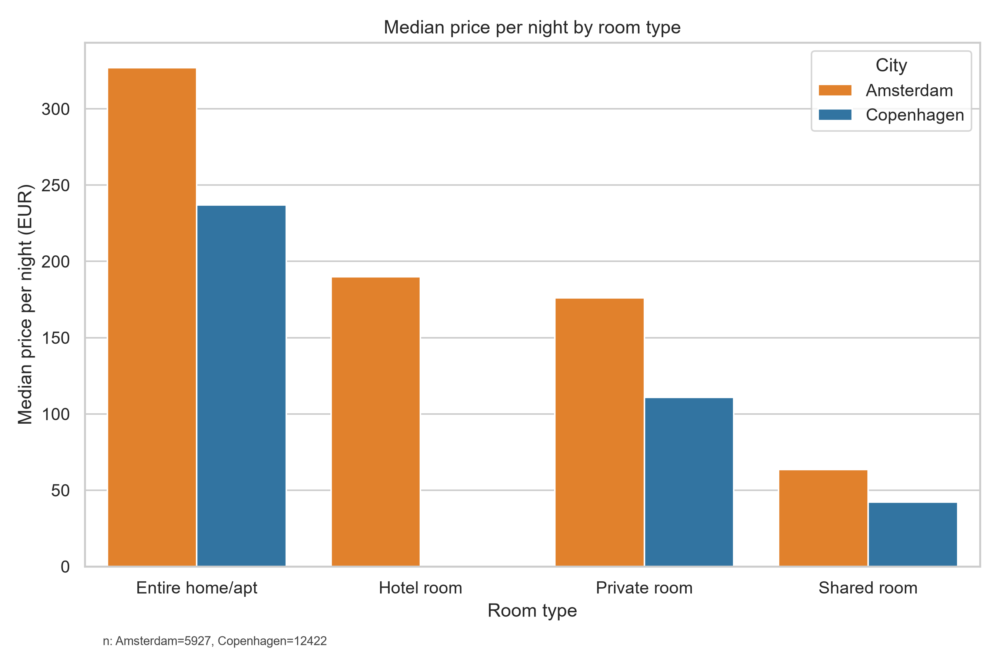
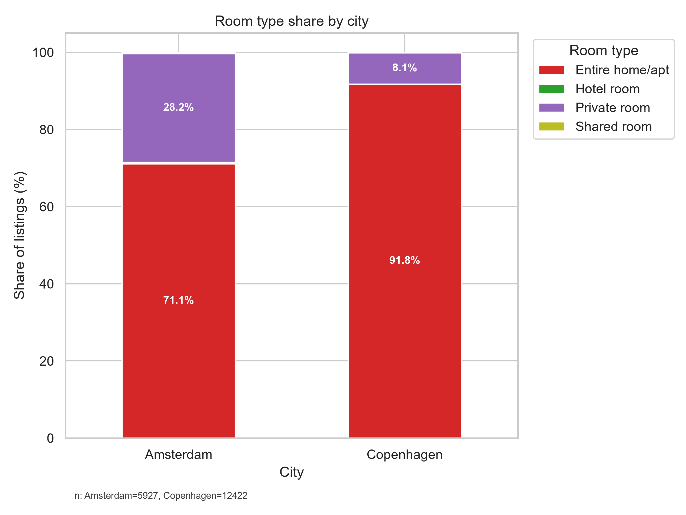
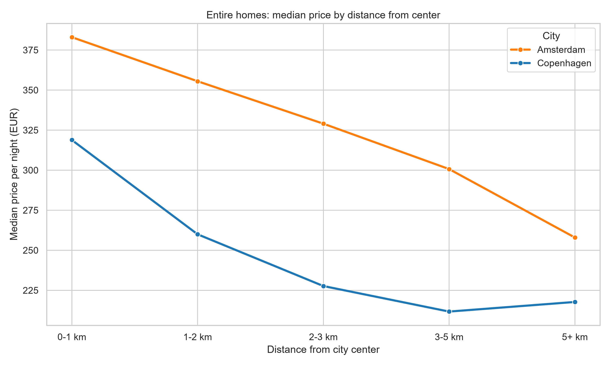
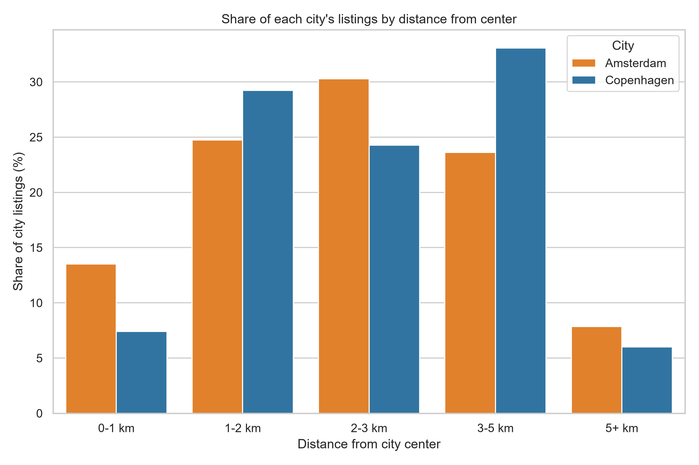

# Airbnb Amsterdam vs Copenhagen: Price, Room Type and Location Analysis

A comparison of the short-term rental markets of Amsterdam and Copenhagen, built from public Inside Airbnb data. The goal is to understand how much more expensive Amsterdam really is when room type and location are taken into account, and how the two cities differ in what is offered.

## Business Questions

- How large is the price gap between Amsterdam and Copenhagen once prices are converted to the same currency and compared by room type?

- How does the mix of listings differ (entire homes vs private rooms)?

- How do prices change with distance from the city center, for entire homes only?

- Is the supply of listings more concentrated near the center in one city than in the other?

- Does the price gap hold when comparing entire homes of the same size (guest capacity)?


## Data Source

- **Source:** [Inside Airbnb](https://insideairbnb.com/get-the-data/), `listings.csv.gz` and `listings (1).csv.gz` for Amsterdam and Copenhagen.
- **Snapshot date:** 25/09/2026 for Copenhagen | 16/09/2026 for Amsterdam. 

- **Raw data is not included** in this repository. Download both files from Inside Airbnb and place them as shown in the structure below.


### Data Dictionary (columns used)

| Column | Meaning |
|---|---|
| `price` | Advertised nightly price (asking price, not the final transaction price) |
| `room_type` | Entire home/apt, Private room, Shared room, Hotel room |
| `latitude`, `longitude` | Listing coordinates |
| `accommodates` | Maximum number of guests the listing can host (used as the size control) |
| `availability_365` | Days the listing is available over the next year |
| `number_of_reviews_ltm` | Reviews received in the last 12 months |
| `market_city` *(derived)* | Amsterdam or Copenhagen |
| `distance` *(derived)* | Distance in km from the city center, via the haversine formula |
| `distance_band` *(derived)* | 0-1, 1-2, 2-3, 3-5, 5+ km |
| `size_band` *(derived)* | Entire homes only: 1-2, 3-4, 5+ guests |
| `price_per_guest` *(derived)* | Nightly price divided by `accommodates` |

## Repository Structure

```
airbnb-amsterdam-vs-copenhagen/
├── README.md
├── requirements.txt
├── analysis.py                              # cleaning and filtering, exports the processed dataset
├── business_insights.py                     # distance calculation, summary tables and the 4 charts
├── size_control.py                          # entire-home prices by guest capacity (size control)
├── CHART_median_price_room_type.png
├── CHART_room_type_share.png
├── CHART_price_by_distance_band.png
├── CHART_listing_distribution_distance.png
└── DATA/                                    # not included, see "Data Source"
    ├── amsterdam/listings.csv.gz
    └── copenhagen/listings.csv.gz
```

## Methodology

### Data Cleaning and Preprocessing
1. **Price formatting:** removed currency symbols and thousands separators, converted to numeric.
2. **Currency:** Copenhagen prices converted from DKK to EUR at a fixed rate of 0.134. Amsterdam prices are used as provided and treated as EUR. 
3. **Missing or zero prices:** have been removed.
4. **Active listings only:** kept listings with availability above 0 days or at least one review in the last 12 months. Inactive rows have been removed.
5. **Outliers:** removed listings above EUR 1,000 per night, applied after the currency conversion so the threshold is identical in both cities. 
6. **Final dataset:** 18,349 active listings (5,927 Amsterdam, 12,422 Copenhagen).

### Exploratory Analysis
- Median prices (not averages, because Airbnb prices are skewed by luxury listings) by city and room type.
- Share of each room type within each city.
- Median price of entire homes by distance band from the city center.
- Share of each city's listings falling in each distance band.
- **Size control (entire homes only):** listings grouped by guest capacity (`accommodates`: 1-2, 3-4, 5+ guests). Median nightly price and median price per guest are compared by city within each group, so a 2-person flat is never compared with a 6-person house. Listings with missing `accommodates` are excluded from this step only.

No statistical models or significance tests were used. The results are descriptive.

## Key Insights

### 1. Amsterdam is pricier, but by about 1.4x for entire homes, not 2-3x
The median entire home costs EUR 327.0 per night in Amsterdam against EUR 237.0 in Copenhagen (ratio of 1.38x). A first version of this analysis showed a much larger gap (~7.35x) because Copenhagen dataset coordinates and currency conversions were misaligned. Correcting the pipeline yielded the true market ratio.



### 2. Copenhagen is heavily dominated by entire homes, while Amsterdam has more private rooms
Private rooms make up 28.2% of Amsterdam listings compared to only 8.1% in Copenhagen, where entire homes represent 91.8% of the market.



### 3. Prices fall with distance from the center in both cities, and Amsterdam stays higher at every distance
For entire homes, the median price drops from EUR 383.0 (0-1 km) to EUR 258.0 (5+ km) in Amsterdam, and from EUR 318.8 (0-1 km) to EUR 217.7 (5+ km) in Copenhagen.



### 4. Supply density differs: Copenhagen peaks at 3-5 km, Amsterdam at 2-3 km
Within 1 km of the center, Amsterdam has 13.5% of its listings vs 7.4% for Copenhagen. Copenhagen supply peaks in the 3-5 km band (33.1%), whereas Amsterdam supply is most dense in the 2-3 km band (30.3%).



### 5. Controlling for size: the price ratio holds strongly across all property sizes
Entire homes only, median nightly price (EUR) and median price per guest (EUR):

| Capacity | Amsterdam price | Copenhagen price | Ratio | Amsterdam per guest | Copenhagen per guest | n (AMS / CPH) |
|---|---|---|---|---|---|---|
| 1-2 guests | EUR 275.0 | EUR 195.9 | 1.40x | EUR 138.0 | EUR 98.4 | 2,009 / 4,588 |
| 3-4 guests | EUR 390.0 | EUR 251.2 | 1.55x | EUR 103.0 | EUR 68.8 | 1,950 / 4,422 |
| 5+ guests | EUR 459.2 | EUR 334.6 | 1.37x | EUR 76.3 | EUR 56.9 | 254 / 2,391 |

The ~1.4x price premium for Amsterdam holds consistently across all size categories, peaking slightly at 1.55x for medium-sized homes (3-4 guests).

### Why might the two markets look different? (context, not tested)
The data cannot explain the differences above, but the rules on short-term rentals are a plausible part of the picture:

- **Amsterdam** lets residents rent out their home for at most 30 nights per year to a maximum of four guests, with a permit and a notification to the city for every stay. Since 1 April 2026 the cap is 15 nights in parts of the city centre and De Pijp. Bed and breakfast follows a separate regime. Details: [amsterdam.nl, holiday rentals](https://www.amsterdam.nl/en/housing/holiday-rentals/).
- **Copenhagen** (Denmark) allows homeowners to rent out their primary residence for up to 70 nights per year, and the rule does not override restrictions for tenants, housing cooperatives or owners' associations. The municipality has been getting stronger powers to enforce it. See the [Danish Local article on the new enforcement rules](https://www.thelocal.dk/20260122/copenhagen-and-aarhus-could-crack-down-illegal-home-rentals-with-new-rules).

A stricter cap in Amsterdam is consistent with its smaller number of listings (5,927 vs 12,422 after cleaning) and higher prices.

**Practical reading:** anyone comparing the two markets should compare by room type and distance, not by city averages, because the room-type mix differs strongly between the two cities.

## Limitations

- **Asking prices, not bookings:** advertised prices, not final transaction prices or occupancy rates.
- **Single snapshot:** no seasonality can be analysed (Amsterdam snapshot: 16/09/2026, Copenhagen: 25/09/2026).
- **Reference points:** Dam Square (Amsterdam) and City Hall Square (Copenhagen).
- **Fixed exchange rate:** DKK to EUR at 0.134.
- **Hotel rooms:** missing/zero in Copenhagen data due to labeling conventions.
- **Size control is partial:** `accommodates` is a proxy; quality, amenities, and exact floor area are not captured.

## How to Run

**Requirements:** Python 3.10+, pandas, numpy, matplotlib, seaborn.

```bash
git clone https://github.com/elenamarta558-star/airbnb-amsterdam-vs-copenhagen.git
cd airbnb-amsterdam-vs-copenhagen
pip install -r requirements.txt
```

1. Download the two `listings.csv.gz` files from Inside Airbnb and place them in `DATA/amsterdam/` and `DATA/copenhagen/`.
2. Run `python analysis.py` to clean the data and export the processed file.
3. Run `python business_insights.py` to generate the charts.
4. Run `python size_control.py` to print the size-control tables.

## Author

**Elena**, MSc in Management (Data-Driven Business), NOVA School of Business and Economics.
LinkedIn: https://www.linkedin.com/in/elenamarta/ 
GitHub: https://github.com/elenamarta558-star